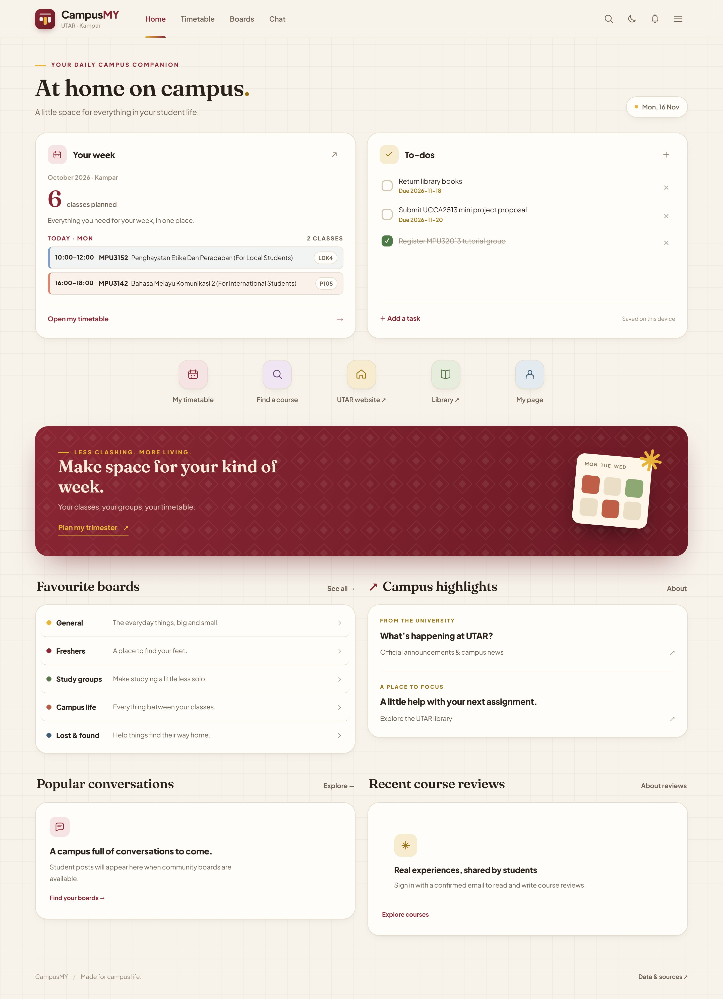
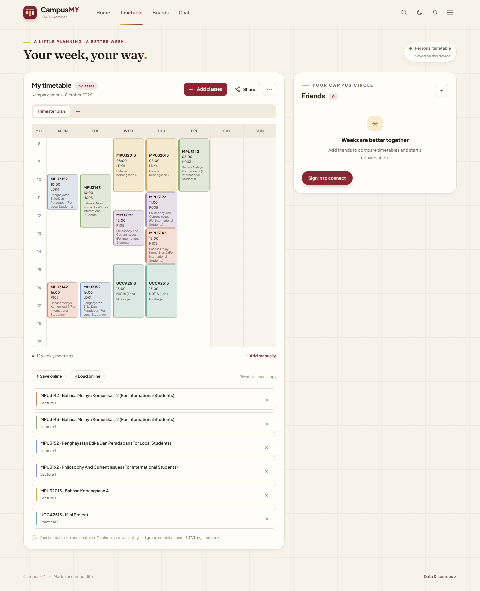
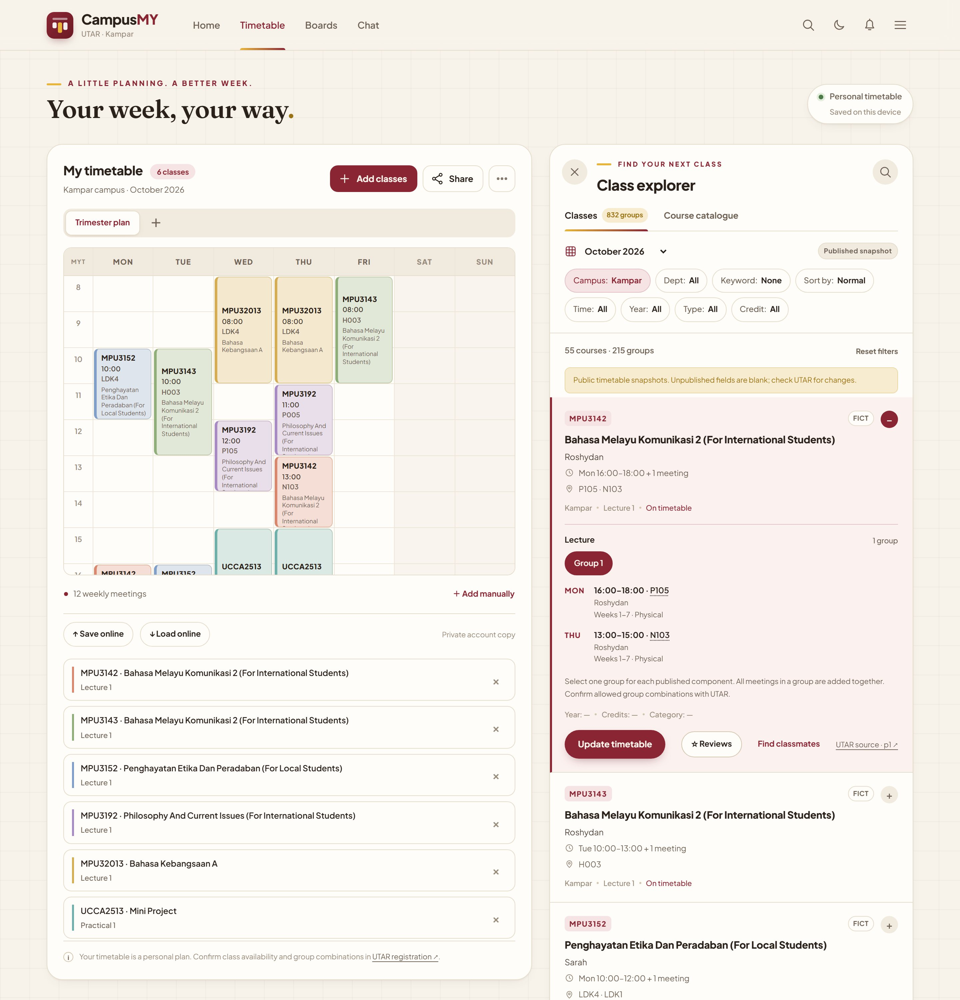
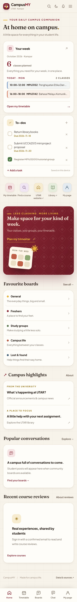
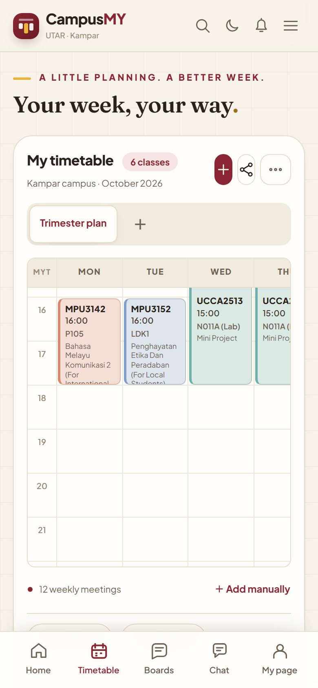

# CampusMY redesign — burgundy & gold (v4.1.0)

Branch: `redesign/campus-identity`, based on `campusmy-website`.

CampusMY now has a visual identity of its own, built from the supplied logo:
burgundy `#8a2634 → #6b1a25` for brand actions and gold `#e8b53a` for accents,
on warm paper surfaces with a faint planner grid. The bright (light) theme is
the default, dark mode is a maroon-tinted charcoal, a sun/moon button in the
header flips between them, and both are driven by one set of design tokens. Every existing feature, filter, privacy control and Supabase
call is untouched; the change is presentation plus a few small quality-of-life
improvements on the Home page.

## Main design choices

**One token system, two themes.** `styles.css` defines colour, radius and
shadow tokens once (`:root` = light). `html[data-theme=dark]` overrides the same tokens, so the
three stylesheets no longer carry hand-tuned dark hex values for every
component. The app opens bright by default; the header toggle and the
Appearance setting in My page (Light / Dark / System default) switch themes
and save the choice to the same preference.

**Brand roles are explicit.** `--brand` is the burgundy *fill* (primary
buttons, selected group pills, badges, "mine" chat bubbles) and always carries
cream text. `--accent` is the burgundy *text/icon* colour; in dark mode it
becomes a rose that stays legible on charcoal. Gold is reserved for emphasis:
the eyebrow bar, active-tab underline, verified/advice highlights, stars and
the headline full stop. It is never used as body text at full brightness
(`--gold-text` is a darker gold that passes contrast on cream).

**Typography.** Plus Jakarta Sans (a Southeast-Asian-designed geometric sans)
for the interface; Fraunces, a warm serif, for page titles and section
headings only. Small text was lifted across the app (most 8–11px labels are now
11–13px) because students read this on phones between classes.

**Malaysian campus texture, kept subtle.** A songket-inspired diamond weave
sits on the Home banner at 8% opacity, the page background carries a faint
planner grid, the hero and banner use the gold eyebrow bar, and the week grid
dims Saturday/Sunday the way a UTAR timetable print-out does.

**States.** Hover, selected, disabled, loading, error and empty states are
styled consistently: selected = burgundy fill; focus = 2px burgundy ring with
offset; disabled = muted fill, no shadow; errors = soft red panel; loading =
spinner on "Checking your account…"; empty states keep the honest copy with a
gold sparkle tile. Touch targets are 40px+ (small controls such as to-do checks
and the ★ favourite button get an invisible 10px halo). `prefers-reduced-motion`
disables the page transition and hover motion.

## Screen by screen

### Home
- Hero, date pill and section layout are unchanged in position; the hero
  headline is now serif with a gold full stop.
- **Today's classes** are listed inside "Your week": time, course code, name
  and room, colour-coded like the calendar, with an honest "No classes today"
  or "Add a class…" message. This reads the already-exported plan
  (`CampusPlanner.exportCurrent`), so nothing new is stored.
- To-dos are ordered incomplete-first, then by due date; due dates show in
  gold.
- Quick links are tinted tiles; the banner is a burgundy brand moment with the
  weave texture and a redrawn mini-timetable illustration.
- Favourite boards get a coloured diamond marker per board; highlights and
  reviews keep their real content and empty states.

### Timetable
- The planner is a card with a clear action row: **Add classes** (filled
  burgundy, labelled), **Share** (labelled) and **Options** (`•••`). Labels
  collapse to icons under 600px.
- Class blocks show code, start time, room and name on a pale tint of the class
  colour with a solid left bar; clashes get a striped red treatment. Weekend
  columns are dimmed.
- On phones the grid keeps readable ~80px day columns and scrolls sideways
  *inside* the calendar only, with the hour axis pinned. The page itself never
  scrolls horizontally (checked at 390px).
- Plan tabs are a segmented control; saved classes are listed as cards with
  their colour bar.
- All existing filters are intact: campus, faculty, trimester, keyword by
  name/lecturer/code, sort, time grid, study year, class type and credits. The
  time-selection grid, check lists and radio lists were restyled, not changed.

### Course selection & reviews
- Course cards: burgundy code chip, faculty tag, bold name, lecturer, then
  time and room lines with clock/pin icons, and the campus · group · "On
  timetable" meta row. Expanded cards show the component picker with
  burgundy-filled selected groups, meeting details with day labels, and the
  action row (**Add to timetable** / **Reviews** / **Find classmates** /
  source link).
- Clicking a saved class still opens its details dialog with **Change
  group**, **Remove class**, **Rate & review** and **Classmates & study
  groups**. Reviews, star rating controls, assessment checks, classmate
  listings and study-group cards were restyled on the same markup; a review's
  "For juniors" advice sits in a gold-edged callout.

### Friends & sharing
- The friends panel shows sharing state at the top: green live dot on a green
  panel when sharing is on, grey dot and "Your timetable is private" when it is
  off, with **Manage** beside it. Friend rows carry an initial avatar, the
  status line and **View timetable / Chat / Manage** actions; incoming requests
  get a filled **Respond** button.
- A friend's timetable is clearly read-only: a gold "VIEW ONLY · Your friend
  controls this timetable" banner with a lock icon sits above the shared grid
  and agenda.
- Invitation (QR / link), scan and request dialogs keep their flows; the QR
  sits on a white card for scanning. **Stop sharing with everyone** remains a
  red text action in the share dialog.

### Chat
- Conversation list with avatars and unread pills on the left; thread on the
  right with a header (name, Timetable, Manage), messages on a faint grid
  background, "mine" bubbles in burgundy aligned right, others in paper aligned
  left, timestamps under each bubble, and a rounded composer with a burgundy
  **Send** button. On phones the list becomes a horizontal strip above the
  thread.

### My page
- Account card with a gold-to-burgundy top rule, verification pill
  (gold = unverified, green = verified) and clear sign-in / create-account
  actions. Settings are grouped into cards (Account, Community, Application,
  Support) with uppercase group labels, chevrons and value text; Sign out is a
  red outline button.

## Files changed

| File | Change |
| --- | --- |
| `index.html` | Google Fonts link, header sun/moon theme toggle, more SVG sprite symbols (plus, share, more, clock, pin, lock, grid, chat…), labelled timetable action buttons, SVG icons instead of glyphs, chat icon in the mobile nav, `v=4.1.0` cache-busting. |
| `styles.css` | Rewritten on tokens: light/dark palettes, base type, timetable planner & calendar (hour rows/axis unchanged at 54px / 43px / 35px), class explorer, course cards, dialogs, forms, responsive rules. |
| `shell.css` | Rewritten: header, Home (incl. today list), quick links, banner, boards/highlights, My page, notifications, boards page, account forms, bottom nav. Per-component light overrides removed (tokens handle it). |
| `social.css` | Rewritten: friends panel, sharing status, social dialogs, read-only view, course space, reviews, chat, shared calendar (38px rows / 30px axis unchanged). |
| `shell.js` | Home week widget lists today's classes; to-dos sorted incomplete-first then by due date; header theme toggle saves the Appearance preference and keeps `theme-color` in sync. |
| `app.js` | Clock/pin/calendar/search SVG icons in cards and empty states; brand-harmonised class colours. |
| `social.js` | SVG icons for the friend search and empty-state sparkle. |
| `account.js` | Default Appearance preference `light` (bright) instead of `dark`; saved preferences are unchanged. |
| `config.js` | Version 4.1.0. |
| `README.md` | Wording for the Add classes button; note on Appearance default and these notes. |
| `docs/REDESIGN.md`, `docs/screenshots/` | This document and the screenshots below. |

The first commit on the branch only expands the previously minified
stylesheets into one declaration per line (verified byte-identical ignoring
whitespace) so the redesign can be reviewed as a real diff.

## Behaviour preserved

- No Supabase call, RPC name, table, policy or auth flow was changed.
  `account.js` differs only in the default theme value; the header toggle
  writes the existing preference through `savePreferences`.
- All planner logic (`app.js`) is untouched apart from icon markup and the
  colour list; the calendar's positioning constants in CSS match the JS exactly.
- Friends, sharing, chat, reviews, classmates and study groups render from the
  same template strings with the same `data-social` actions.
- Privacy copy, read-only sharing, revocation and the email-confirmation gate
  are unchanged.

## Checks performed

Local checks (served with `python -m http.server 4173`, Chromium):

- Pages render in light and dark, desktop (1280–1440px) and phone (390px),
  with no console errors.
- No page-wide horizontal scroll at 390px on Home and Timetable
  (`scrollWidth === innerWidth`); the week grid scrolls inside its own shell.
- Timetable: add a class from the explorer, choose a group, view the class
  block, open class details, change group, remove class, open the time-grid /
  study-year / keyword filters, reset filters, switch trimester, open the
  Options menu, Save/Load online buttons present.
- Home: class count, Today list and to-do ordering update from the saved plan.
- Dialogs: sign in / create account forms, Share gate for signed-out users,
  class details, filters; focus rings visible with keyboard.
- Appearance: opens light regardless of the OS setting; the header toggle
  switches to dark, persists across reload and is reflected in My page →
  Appearance; System default still follows the OS when chosen.

Not exercised here (needs confirmed accounts, as before): live sign-in,
signed-in friends/sharing/chat/review flows against Supabase. Those screens use
the same classes as the signed-out states that were checked, but a two-account
acceptance pass is still recommended before deploying.

## Screenshots

Captured with headless Chrome at 2× from a guest (device-only) timetable seeded
with six real October 2026 Kampar classes from the bundled data, three example
to-dos, and the clock fixed to Monday 16 November 2026 so the Today list has
content. No reviews, friends or messages were fabricated.

Desktop (1440px): `desktop-home`, `desktop-timetable`, `desktop-class-explorer`,
`desktop-class-details`, `desktop-time-filter`, `desktop-share-timetable`,
`desktop-chat`, `desktop-sign-in`, `desktop-my-page`, plus `-dark` variants of
Home, Timetable and My page.

Mobile (390px): `mobile-home`, `mobile-timetable`, `mobile-class-explorer`,
`mobile-chat`, `mobile-my-page`, plus `-dark` variants of Home and Timetable.

